## 适用于mihomo - MetacubeX面板的Icon

# 使用前：

        需要了解编写规则配置(*.ymal)

        需要了解使用mihomo - MetacubeX面板
        

# 使用指南：

#### 1、Icons的命名本质上不和你的策略组相关联。

2、建议同步到本地，便于阅读

3、Icons地址请使用raw地址

        例如：https://raw.githubusercontent.com/Vbaethon/HOMOMIX/main/Icon/Color/China.png

#### 4、面板可以调节尺寸与距离

# Icon版本：

        等高版本（默认设置, “Color/”）
        满高版本（“Color/Large”）

<!--start-icons-->

<table>
<tr>
<td align="center"> <strong>Adblock</strong></td>
<td align="center"><a href="Icon/Color/AdblockPlus.png">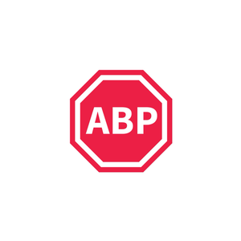</a> <strong>Adblock Plus · 描边版</strong></td>
<td align="center"><a href="Icon/Color/AdblockPlus_2.png">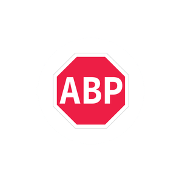</a> <strong>Adblock Plus · 实心版</strong></td>
<td align="center"> <strong>Adguard</strong></td>
<td align="center"><a href="Icon/Color/Adobe.png">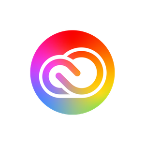</a> <strong>Adobe Creative Cloud</strong></td>
</tr>
<tr>
<td align="center"> <strong>AI</strong></td>
<td align="center"> <strong>AI bot</strong></td>
<td align="center"> <strong>AI Tree</strong></td>
<td align="center"> <strong>AI voice</strong></td>
<td align="center"> <strong>Amazon</strong></td>
</tr>
<tr>
<td align="center"> <strong>Apple</strong></td>
<td align="center"> <strong>Apple black</strong></td>
<td align="center"><a href="Icon/Color/Apple_rainbow.png">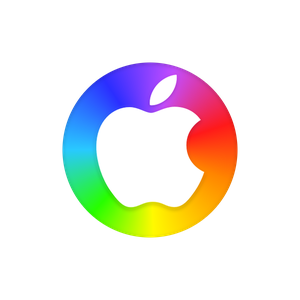</a> <strong>Apple rainbow</strong></td>
<td align="center"> <strong>Apple TV</strong></td>
<td align="center"> <strong>ASIA</strong></td>
</tr>
<tr>
<td align="center"><a href="Icon/Color/Auto_Link.png">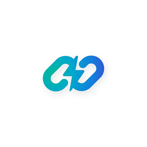</a> <strong>自动链接</strong></td>
<td align="center"><a href="Icon/Color/Bahamut.png">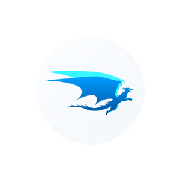</a> <strong>Bahamut</strong></td>
<td align="center"><a href="Icon/Color/Bahamut_b.png">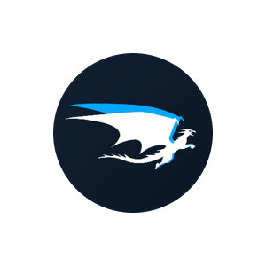</a> <strong>Bahamut b</strong></td>
<td align="center"><a href="Icon/Color/Bahamut_i.png">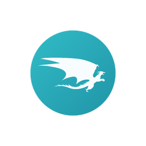</a> <strong>Bahamut i</strong></td>
<td align="center"> <strong>bilibili</strong></td>
</tr>
<tr>
<td align="center"> <strong>Bilibili blue</strong></td>
<td align="center"> <strong>Bilibili Global</strong></td>
<td align="center"> <strong>Binance</strong></td>
<td align="center"> <strong>Bing</strong></td>
<td align="center"> <strong>Bitcoin</strong></td>
</tr>
<tr>
<td align="center"> <strong>Bluesky</strong></td>
<td align="center"><a href="Icon/Color/BT_Bittorrent.png">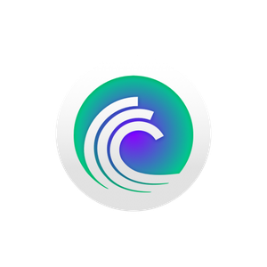</a> <strong>BT Bittorrent</strong></td>
<td align="center"> <strong>Bytedance</strong></td>
<td align="center"> <strong>Calcifer</strong></td>
<td align="center"><a href="Icon/Color/Chained.png">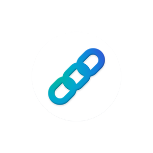</a> <strong>链式连接 · 三环</strong></td>
</tr>
<tr>
<td align="center"> <strong>链式连接 · 双环</strong></td>
<td align="center"><a href="Icon/Color/ChatGPT.png">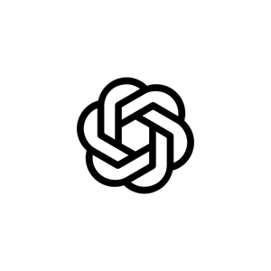</a> <strong>ChatGPT</strong></td>
<td align="center"> <strong>China</strong></td>
<td align="center"> <strong>China Taipei</strong></td>
<td align="center"> <strong>Claude</strong></td>
</tr>
<tr>
<td align="center"> <strong>SoundCloud</strong></td>
<td align="center"> <strong>CloudFlare</strong></td>
<td align="center"> <strong>Consistent Hashing</strong></td>
<td align="center"> <strong>Crypto</strong></td>
<td align="center"><a href="Icon/Color/DeepSeek.png">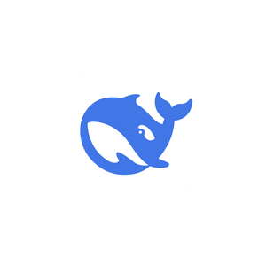</a> <strong>DeepSeek</strong></td>
</tr>
<tr>
<td align="center"> <strong>DIRECT</strong></td>
<td align="center"> <strong>Discord</strong></td>
<td align="center"> <strong>Disney</strong></td>
<td align="center"> <strong>Disney Castle</strong></td>
<td align="center"> <strong>Disney Channel</strong></td>
</tr>
<tr>
<td align="center"><a href="Icon/Color/Disney_Mickey.png">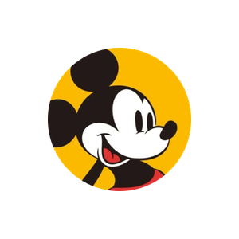</a> <strong>Disney Mickey</strong></td>
<td align="center"> <strong>Disney plus</strong></td>
<td align="center"> <strong>Dolphin</strong></td>
<td align="center"> <strong>Douyin</strong></td>
<td align="center"> <strong>Download</strong></td>
</tr>
<tr>
<td align="center"> <strong>Emby</strong></td>
<td align="center"> <strong>EPIC</strong></td>
<td align="center"> <strong>European Union</strong></td>
<td align="center"><a href="Icon/Color/F2C.png">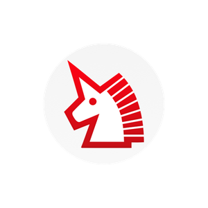</a> <strong>FC2</strong></td>
<td align="center"> <strong>Facebook</strong></td>
</tr>
<tr>
<td align="center"><a href="Icon/Color/Failover.png">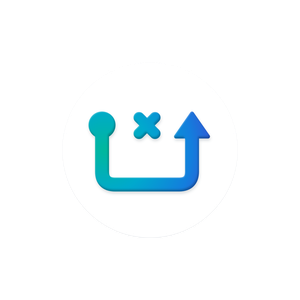</a> <strong>Failover</strong></td>
<td align="center"> <strong>Fast</strong></td>
<td align="center"> <strong>FCM Firebase Cloud Messaging</strong></td>
<td align="center"><a href="Icon/Color/Fish.png">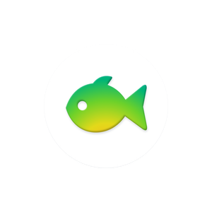</a> <strong>Fish</strong></td>
<td align="center"><a href="Icon/Color/Fish_b.png">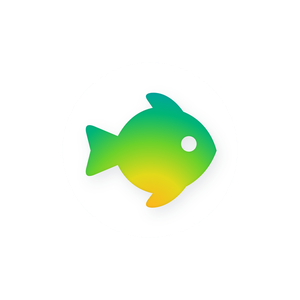</a> <strong>Fish b</strong></td>
</tr>
<tr>
<td align="center"><a href="Icon/Color/Fish_x.png">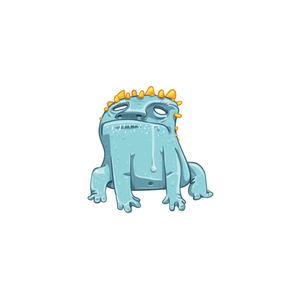</a> <strong>Fish x</strong></td>
<td align="center"> <strong>Flight</strong></td>
<td align="center"><a href="Icon/Color/Forbidden.png">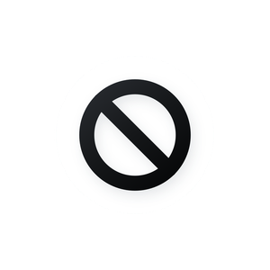</a> <strong>Forbidden</strong></td>
<td align="center"> <strong>Game</strong></td>
<td align="center"><a href="Icon/Color/Gemini.png">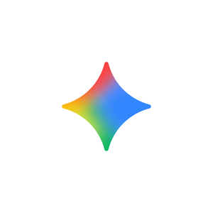</a> <strong>Gemini</strong></td>
</tr>
<tr>
<td align="center"> <strong>GFW</strong></td>
<td align="center"><a href="Icon/Color/GitHub.png">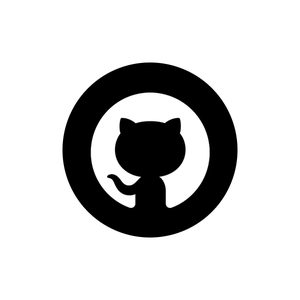</a> <strong>GitHub</strong></td>
<td align="center"> <strong>Global</strong></td>
<td align="center"> <strong>Globefish</strong></td>
<td align="center"> <strong>Gmail</strong></td>
</tr>
<tr>
<td align="center"> <strong>GOG</strong></td>
<td align="center"> <strong>Google</strong></td>
<td align="center"> <strong>Grok</strong></td>
<td align="center"> <strong>HBO MAX</strong></td>
<td align="center"><a href="Icon/Color/Home.png">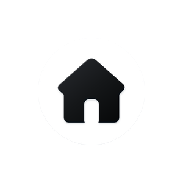</a> <strong>Home</strong></td>
</tr>
<tr>
<td align="center"> <strong>Hong Kong</strong></td>
<td align="center"><a href="Icon/Color/Huawei.png">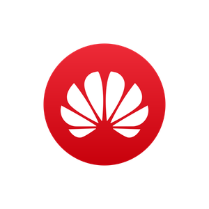</a> <strong>Huawei</strong></td>
<td align="center"><a href="Icon/Color/Huawei_black.png">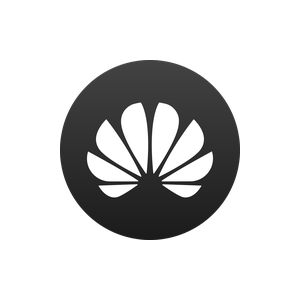</a> <strong>Huawei black</strong></td>
<td align="center"><a href="Icon/Color/Huawei_white.png">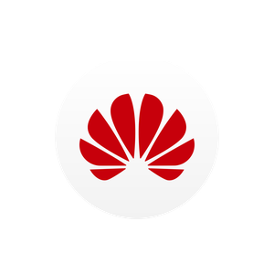</a> <strong>Huawei white</strong></td>
<td align="center"> <strong>Hugging Face · 白底</strong></td>
</tr>
<tr>
<td align="center"> <strong>Hugging Face · 绿底</strong></td>
<td align="center"> <strong>Hulu</strong></td>
<td align="center"> <strong>Infuse</strong></td>
<td align="center"> <strong>Instagram</strong></td>
<td align="center"> <strong>Japan</strong></td>
</tr>
<tr>
<td align="center"><a href="Icon/Color/Jellyfin.png">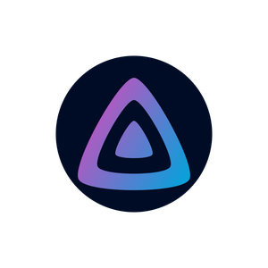</a> <strong>Jellyfin</strong></td>
<td align="center"> <strong>Linkedin</strong></td>
<td align="center"> <strong>Linkedin ray</strong></td>
<td align="center"> <strong>负载均衡 · 分配器</strong></td>
<td align="center"> <strong>负载均衡 · 三仓</strong></td>
</tr>
<tr>
<td align="center"><a href="Icon/Color/Load_balancing_3.png">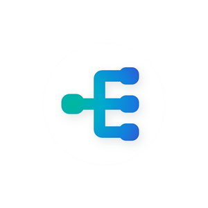</a> <strong>负载均衡 · 平衡台</strong></td>
<td align="center"><a href="Icon/Color/Location.png">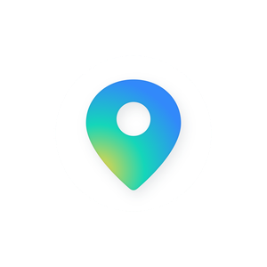</a> <strong>Location</strong></td>
<td align="center"><a href="Icon/Color/Magic_Timer.png">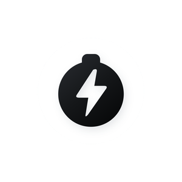</a> <strong>Magic Timer</strong></td>
<td align="center"> <strong>Mail</strong></td>
<td align="center"> <strong>Messenger</strong></td>
</tr>
<tr>
<td align="center"><a href="Icon/Color/Meta_1.png">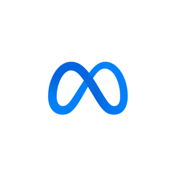</a> <strong>Meta 1</strong></td>
<td align="center"> <strong>Microsoft</strong></td>
<td align="center"> <strong>Microsoft 365</strong></td>
<td align="center"> <strong>Microsoft Copilot</strong></td>
<td align="center"> <strong>MLB</strong></td>
</tr>
<tr>
<td align="center"> <strong>NBA</strong></td>
<td align="center"> <strong>Netflix</strong></td>
<td align="center"> <strong>Netflix b</strong></td>
<td align="center"><a href="Icon/Color/Network.png">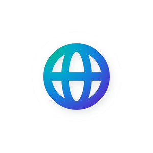</a> <strong>Network</strong></td>
<td align="center"> <strong>Network 2</strong></td>
</tr>
<tr>
<td align="center"> <strong>Niconico</strong></td>
<td align="center"> <strong>Niconico Live</strong></td>
<td align="center"> <strong>Niconico Manga</strong></td>
<td align="center"> <strong>Olympic Rings</strong></td>
<td align="center"><a href="Icon/Color/Omission.png">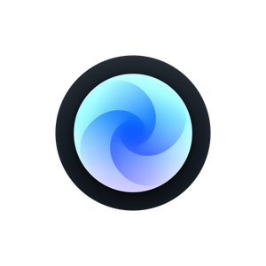</a> <strong>Microsoft Edge（Omission 策略）</strong></td>
</tr>
<tr>
<td align="center"> <strong>OneDrive</strong></td>
<td align="center"> <strong>Onlyfans</strong></td>
<td align="center"> <strong>Other</strong></td>
<td align="center"> <strong>Outlook</strong></td>
<td align="center"> <strong>Palestine</strong></td>
</tr>
<tr>
<td align="center"> <strong>Panda</strong></td>
<td align="center"> <strong>Panda ai</strong></td>
<td align="center"><a href="Icon/Color/Panda_WWF.png">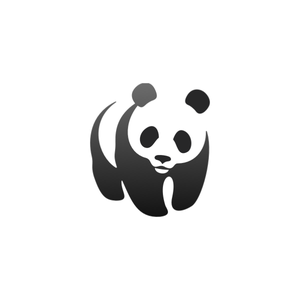</a> <strong>Panda WWF</strong></td>
<td align="center"> <strong>PayPal</strong></td>
<td align="center"> <strong>PayPal business</strong></td>
</tr>
<tr>
<td align="center"><a href="Icon/Color/Peacook.png">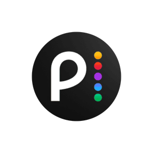</a> <strong>Peacook</strong></td>
<td align="center"><a href="Icon/Color/Perplexity.png">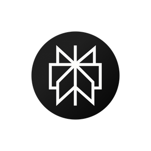</a> <strong>Perplexity</strong></td>
<td align="center"> <strong>Pig</strong></td>
<td align="center"> <strong>Piggies</strong></td>
<td align="center"><a href="Icon/Color/Piggies_b.png">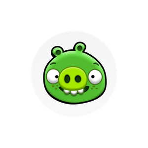</a> <strong>Piggies b</strong></td>
</tr>
<tr>
<td align="center"> <strong>Pixiv</strong></td>
<td align="center"> <strong>PlayStation</strong></td>
<td align="center"> <strong>PlayStation · 30th Anniversary</strong></td>
<td align="center"> <strong>PlayStation · Remote Play</strong></td>
<td align="center"> <strong>Plex</strong></td>
</tr>
<tr>
<td align="center"> <strong>Pornhub</strong></td>
<td align="center"> <strong>Prime</strong></td>
<td align="center"> <strong>Qoura</strong></td>
<td align="center"> <strong>Reddit</strong></td>
<td align="center"> <strong>Remote</strong></td>
</tr>
<tr>
<td align="center"><a href="Icon/Color/Round_Robin.png">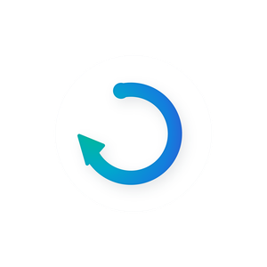</a> <strong>Round Robin</strong></td>
<td align="center"> <strong>Scholar</strong></td>
<td align="center"> <strong>Seancody</strong></td>
<td align="center"> <strong>Server</strong></td>
<td align="center"> <strong>Settings</strong></td>
</tr>
<tr>
<td align="center"> <strong>Signal Light</strong></td>
<td align="center"> <strong>Singapore</strong></td>
<td align="center"> <strong>SNS</strong></td>
<td align="center"> <strong>Sony Live</strong></td>
<td align="center"> <strong>South Korea</strong></td>
</tr>
<tr>
<td align="center"> <strong>SpeedTest</strong></td>
<td align="center"> <strong>Spotify</strong></td>
<td align="center"> <strong>Steam</strong></td>
<td align="center"> <strong>Stream</strong></td>
<td align="center"><a href="Icon/Color/Taiwan_Province.png">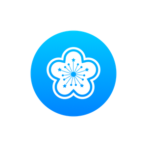</a> <strong>Taiwan Province</strong></td>
</tr>
<tr>
<td align="center"> <strong>Telegram</strong></td>
<td align="center"> <strong>Threads</strong></td>
<td align="center"> <strong>Tick</strong></td>
<td align="center"> <strong>Tick 2</strong></td>
<td align="center"> <strong>TikTok</strong></td>
</tr>
<tr>
<td align="center"> <strong>Transfer</strong></td>
<td align="center"> <strong>Twitch</strong></td>
<td align="center"> <strong>UBISOFT</strong></td>
<td align="center"> <strong>UK</strong></td>
<td align="center"> <strong>USA</strong></td>
</tr>
<tr>
<td align="center"> <strong>Video Vimeo</strong></td>
<td align="center"> <strong>Vimeo</strong></td>
<td align="center"> <strong>Weibo</strong></td>
<td align="center"> <strong>WhatsApp</strong></td>
<td align="center"> <strong>X</strong></td>
</tr>
<tr>
<td align="center"> <strong>Xbox</strong></td>
<td align="center"> <strong>xHamster</strong></td>
<td align="center"> <strong>Xianyu</strong></td>
<td align="center"> <strong>Yin Yang</strong></td>
<td align="center"> <strong>YouTube</strong></td>
</tr>
<tr>
<td align="center"> <strong>Zoho new</strong></td>
<td align="center"><a href="Icon/Color/Zune.png">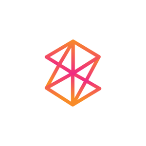</a> <strong>Zune</strong></td>
</tr>
</table>

<!--end-icons-->

## 效果

| 大小对比（手机截图） |
|---|
|  |
