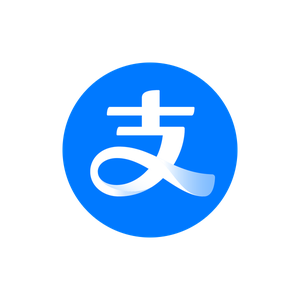
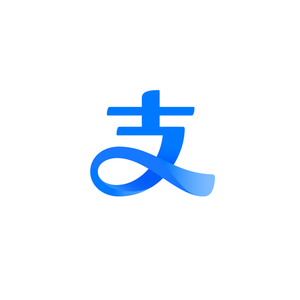
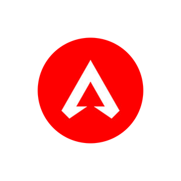
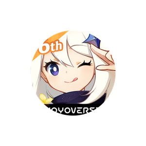
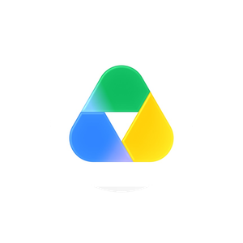
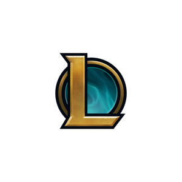
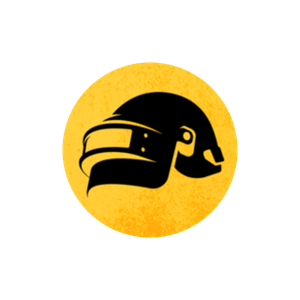

## 适用于mihomo - MetacubeX面板的Icon

# 使用前：

        需要了解编写规则配置(*.ymal)

        需要了解使用mihomo - MetacubeX面板
        

# 使用指南：

#### 1、Icons的命名本质上不和你的策略组相关联。

2、建议同步到本地，便于阅读

3、Icons地址请使用raw地址

        例如：https://raw.githubusercontent.com/Vbaethon/HOMOMIX/main/Icon/Color/China.png

#### 4、面板可以调节尺寸与距离

# Icon版本：

        等高版本（默认设置, “Color/”）
        满高版本（“Color/Large”）

<!--start-icons-->

<table>
<tr>
<td align="center"> <strong>Adblock</strong></td>
<td align="center"> <strong>AdblockPlus</strong></td>
<td align="center"> <strong>AdblockPlus_2</strong></td>
<td align="center"> <strong>Adguard</strong></td>
<td align="center"> <strong>Adobe</strong></td>
</tr>
<tr>
<td align="center"> <strong>AI</strong></td>
<td align="center"> <strong>AI_bot</strong></td>
<td align="center"> <strong>AI_Tree</strong></td>
<td align="center"> <strong>AI_voice</strong></td>
<td align="center"> <strong>Alipay</strong></td>
</tr>
<tr>
<td align="center"> <strong>Alipay_black</strong></td>
<td align="center"> <strong>Alipay_white</strong></td>
<td align="center"> <strong>Amazon</strong></td>
<td align="center"> <strong>Apex_Legends</strong></td>
<td align="center"> <strong>Apple</strong></td>
</tr>
<tr>
<td align="center"> <strong>Apple_black</strong></td>
<td align="center"> <strong>Apple_Music</strong></td>
<td align="center"> <strong>Apple_rainbow</strong></td>
<td align="center"> <strong>Apple_TV</strong></td>
<td align="center"> <strong>ASIA</strong></td>
</tr>
<tr>
<td align="center"> <strong>Auto_Link</strong></td>
<td align="center"> <strong>Bahamut</strong></td>
<td align="center"> <strong>Bahamut_b</strong></td>
<td align="center"> <strong>Bahamut_i</strong></td>
<td align="center"> <strong>Battle_net</strong></td>
</tr>
<tr>
<td align="center"> <strong>bilibili</strong></td>
<td align="center"> <strong>Bilibili_blue</strong></td>
<td align="center"> <strong>Bilibili_Global</strong></td>
<td align="center"> <strong>Binance</strong></td>
<td align="center"> <strong>Bing</strong></td>
</tr>
<tr>
<td align="center"> <strong>Bitcoin</strong></td>
<td align="center"> <strong>Bluesky</strong></td>
<td align="center"> <strong>BT_Bittorrent</strong></td>
<td align="center"> <strong>Bytedance</strong></td>
<td align="center"> <strong>Calcifer</strong></td>
</tr>
<tr>
<td align="center"> <strong>Chained</strong></td>
<td align="center"> <strong>Chained_2</strong></td>
<td align="center"> <strong>ChatGPT</strong></td>
<td align="center"> <strong>China</strong></td>
<td align="center"> <strong>China_Taipei</strong></td>
</tr>
<tr>
<td align="center"> <strong>Claude</strong></td>
<td align="center"> <strong>Cloud</strong></td>
<td align="center"> <strong>CloudFlare</strong></td>
<td align="center"> <strong>Consistent_Hashing</strong></td>
<td align="center"> <strong>Crunchyroll</strong></td>
</tr>
<tr>
<td align="center"> <strong>Crypto</strong></td>
<td align="center"> <strong>CS2</strong></td>
<td align="center"> <strong>DeepSeek</strong></td>
<td align="center"> <strong>DIRECT</strong></td>
<td align="center"> <strong>Discord</strong></td>
</tr>
<tr>
<td align="center"> <strong>Discovery_plus</strong></td>
<td align="center"> <strong>Disney</strong></td>
<td align="center"> <strong>Disney_Castle</strong></td>
<td align="center"> <strong>Disney_Channel</strong></td>
<td align="center"> <strong>Disney_Mickey</strong></td>
</tr>
<tr>
<td align="center"> <strong>Disney_plus</strong></td>
<td align="center"> <strong>Dolphin</strong></td>
<td align="center"> <strong>Douyin</strong></td>
<td align="center"> <strong>Download</strong></td>
<td align="center"> <strong>EA_App</strong></td>
</tr>
<tr>
<td align="center"> <strong>Emby</strong></td>
<td align="center"> <strong>EPIC</strong></td>
<td align="center"> <strong>European_Union</strong></td>
<td align="center"> <strong>F2C</strong></td>
<td align="center"> <strong>Facebook</strong></td>
</tr>
<tr>
<td align="center"> <strong>Failover</strong></td>
<td align="center"> <strong>Fast</strong></td>
<td align="center"> <strong>FCM_Firebase_Cloud_Messaging</strong></td>
<td align="center"> <strong>Fish</strong></td>
<td align="center"> <strong>Fish_b</strong></td>
</tr>
<tr>
<td align="center"> <strong>Fish_x</strong></td>
<td align="center"> <strong>Flight</strong></td>
<td align="center"> <strong>Forbidden</strong></td>
<td align="center"> <strong>Game</strong></td>
<td align="center"> <strong>Gemini</strong></td>
</tr>
<tr>
<td align="center"> <strong>Genshin_Impact</strong></td>
<td align="center"> <strong>GFW</strong></td>
<td align="center"> <strong>GitHub</strong></td>
<td align="center"> <strong>Global</strong></td>
<td align="center"> <strong>Globefish</strong></td>
</tr>
<tr>
<td align="center"> <strong>Gmail</strong></td>
<td align="center"> <strong>GOG</strong></td>
<td align="center"> <strong>Google</strong></td>
<td align="center"> <strong>Google_Drive</strong></td>
<td align="center"> <strong>Google_Play</strong></td>
</tr>
<tr>
<td align="center"> <strong>Grok</strong></td>
<td align="center"> <strong>HBO</strong></td>
<td align="center"> <strong>HBO_MAX</strong></td>
<td align="center"> <strong>Home</strong></td>
<td align="center"> <strong>Hong_Kong</strong></td>
</tr>
<tr>
<td align="center"> <strong>Honkai_Star_Rail</strong></td>
<td align="center"> <strong>Huawei</strong></td>
<td align="center"> <strong>Huawei_black</strong></td>
<td align="center"> <strong>Huawei_white</strong></td>
<td align="center"> <strong>Hugging_face</strong></td>
</tr>
<tr>
<td align="center"> <strong>Hugging_face_g</strong></td>
<td align="center"> <strong>Hulu</strong></td>
<td align="center"> <strong>Infuse</strong></td>
<td align="center"> <strong>Instagram</strong></td>
<td align="center"> <strong>iQIYI</strong></td>
</tr>
<tr>
<td align="center"> <strong>Japan</strong></td>
<td align="center"> <strong>Jellyfin</strong></td>
<td align="center"> <strong>League_of_Legends</strong></td>
<td align="center"> <strong>Linkedin</strong></td>
<td align="center"> <strong>Linkedin_ray</strong></td>
</tr>
<tr>
<td align="center"> <strong>Load_balancing</strong></td>
<td align="center"> <strong>Load_balancing_2</strong></td>
<td align="center"> <strong>Load_balancing_3</strong></td>
<td align="center"> <strong>Location</strong></td>
<td align="center"> <strong>Magic_Timer</strong></td>
</tr>
<tr>
<td align="center"> <strong>Mail</strong></td>
<td align="center"> <strong>MangoTV</strong></td>
<td align="center"> <strong>Messenger</strong></td>
<td align="center"> <strong>Meta_1</strong></td>
<td align="center"> <strong>Microsoft</strong></td>
</tr>
<tr>
<td align="center"> <strong>Microsoft_365</strong></td>
<td align="center"> <strong>Microsoft_Copilot</strong></td>
<td align="center"> <strong>MLB</strong></td>
<td align="center"> <strong>NBA</strong></td>
<td align="center"> <strong>Netflix</strong></td>
</tr>
<tr>
<td align="center"> <strong>Netflix_b</strong></td>
<td align="center"> <strong>Network</strong></td>
<td align="center"> <strong>Network_2</strong></td>
<td align="center"> <strong>Niconico</strong></td>
<td align="center"> <strong>Niconico_Live</strong></td>
</tr>
<tr>
<td align="center"> <strong>Niconico_Manga</strong></td>
<td align="center"> <strong>Nintendo_Switch</strong></td>
<td align="center"> <strong>Olympics</strong></td>
<td align="center"> <strong>Omission</strong></td>
<td align="center"> <strong>OneDrive</strong></td>
</tr>
<tr>
<td align="center"> <strong>Onlyfans</strong></td>
<td align="center"> <strong>Other</strong></td>
<td align="center"> <strong>Outlook</strong></td>
<td align="center"> <strong>Overwatch</strong></td>
<td align="center"> <strong>Palestine</strong></td>
</tr>
<tr>
<td align="center"> <strong>Panda</strong></td>
<td align="center"> <strong>Panda_ai</strong></td>
<td align="center"> <strong>Panda_WWF</strong></td>
<td align="center"> <strong>Paramount_plus</strong></td>
<td align="center"> <strong>PayPal</strong></td>
</tr>
<tr>
<td align="center"> <strong>PayPal_business</strong></td>
<td align="center"> <strong>Peacook</strong></td>
<td align="center"> <strong>Perplexity</strong></td>
<td align="center"> <strong>Pig</strong></td>
<td align="center"> <strong>Piggies</strong></td>
</tr>
<tr>
<td align="center"> <strong>Piggies_b</strong></td>
<td align="center"> <strong>Pixiv</strong></td>
<td align="center"> <strong>Playstation</strong></td>
<td align="center"> <strong>Playstation_30th</strong></td>
<td align="center"> <strong>Playstation_remote</strong></td>
</tr>
<tr>
<td align="center"> <strong>Plex</strong></td>
<td align="center"> <strong>Pornhub</strong></td>
<td align="center"> <strong>Prime</strong></td>
<td align="center"> <strong>PUBG</strong></td>
<td align="center"> <strong>Qoura</strong></td>
</tr>
<tr>
<td align="center"> <strong>Reddit</strong></td>
<td align="center"> <strong>Remote</strong></td>
<td align="center"> <strong>Round_Robin</strong></td>
<td align="center"> <strong>Scholar</strong></td>
<td align="center"> <strong>Seancody</strong></td>
</tr>
<tr>
<td align="center"> <strong>Server</strong></td>
<td align="center"> <strong>Settings</strong></td>
<td align="center"> <strong>Signal</strong></td>
<td align="center"> <strong>Signal_Light</strong></td>
<td align="center"> <strong>Singapore</strong></td>
</tr>
<tr>
<td align="center"> <strong>SNS</strong></td>
<td align="center"> <strong>Sony_Live</strong></td>
<td align="center"> <strong>South_Korea</strong></td>
<td align="center"> <strong>SpeedTest</strong></td>
<td align="center"> <strong>Spotify</strong></td>
</tr>
<tr>
<td align="center"> <strong>Steam</strong></td>
<td align="center"> <strong>Stream</strong></td>
<td align="center"> <strong>Taiwan_Province</strong></td>
<td align="center"> <strong>Telegram</strong></td>
<td align="center"> <strong>Threads</strong></td>
</tr>
<tr>
<td align="center"> <strong>Tick</strong></td>
<td align="center"> <strong>Tick_2</strong></td>
<td align="center"> <strong>TikTok</strong></td>
<td align="center"> <strong>Transfer</strong></td>
<td align="center"> <strong>Twitch</strong></td>
</tr>
<tr>
<td align="center"> <strong>Twitter</strong></td>
<td align="center"> <strong>UBISOFT</strong></td>
<td align="center"> <strong>UK</strong></td>
<td align="center"> <strong>USA</strong></td>
<td align="center"> <strong>Valorant</strong></td>
</tr>
<tr>
<td align="center"> <strong>Video_Vimeo</strong></td>
<td align="center"> <strong>Vimeo</strong></td>
<td align="center"> <strong>WeChat</strong></td>
<td align="center"> <strong>Weibo</strong></td>
<td align="center"> <strong>WeTV</strong></td>
</tr>
<tr>
<td align="center"> <strong>WhatsApp</strong></td>
<td align="center"> <strong>X</strong></td>
<td align="center"> <strong>Xbox</strong></td>
<td align="center"> <strong>xHamster</strong></td>
<td align="center"> <strong>Xianyu</strong></td>
</tr>
<tr>
<td align="center"> <strong>Yin_Yang</strong></td>
<td align="center"> <strong>YouTube</strong></td>
<td align="center"> <strong>Zoho_new</strong></td>
<td align="center"> <strong>Zoho_old</strong></td>
<td align="center"> <strong>Zune</strong></td>
</tr>
</table>

<!--end-icons-->

## 效果

| 大小对比（手机截图） |
|---|
|  |
