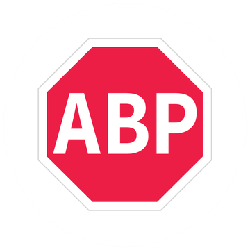
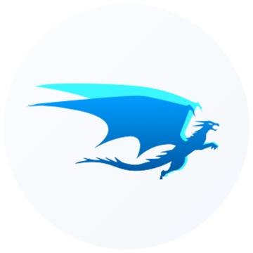
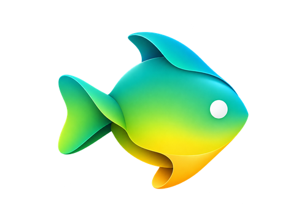
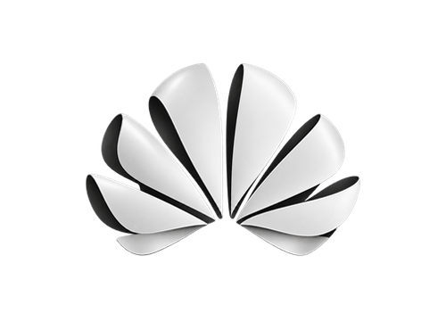
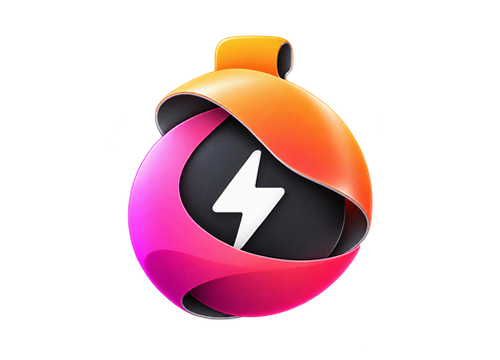
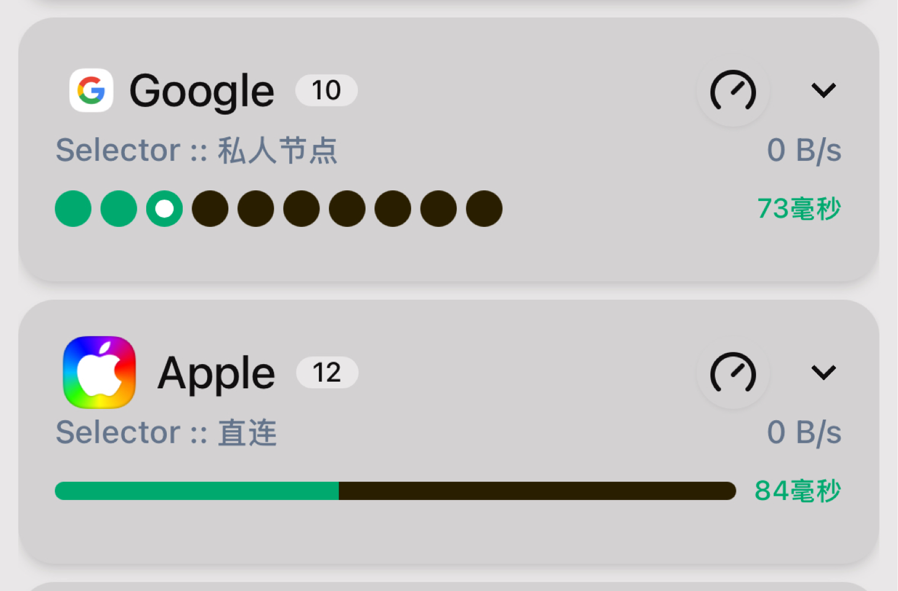

## 适用于mihomo - MetacubeX面板的Icon

# 使用前：

        需要了解编写规则配置(*.ymal)

        需要了解使用mihomo - MetacubeX面板
        

# 使用指南：

#### 1、Icons的命名本质上不和你的策略组相关联。

2、建议同步到本地，便于阅读

3、Icons地址请使用raw地址

        例如：https://raw.githubusercontent.com/Vbaethon/HOMOMIX/main/Icon/Color/China.png

#### 4、面板可以调节尺寸与距离

# Icon版本：

        等高版本（默认设置, “Color/”）
        满高版本（“Color/Large”）
        FDS版本（“Icon/Color/FDS”）

<!--start-icons-->

<table>
<tr>
<td colspan="2" width="320" align="center"><strong title="Adblock.png">Adblock</strong></td>
<td colspan="2" width="320" align="center"><strong title="AdblockPlus.png">AdblockPlus</strong></td>
<td colspan="2" width="320" align="center"><strong title="AdblockPlus_2.png">AdblockPlus_2</strong></td>
<td colspan="2" width="320" align="center"><strong title="Adguard.png">Adguard</strong></td>
</tr>
<tr>
<td width="160" align="center" valign="middle"></td>
<td width="160" align="center" valign="middle"></td>
<td width="160" align="center" valign="middle"></td>
<td width="160" align="center" valign="middle"></td>
<td width="160" align="center" valign="middle"></td>
<td width="160" align="center" valign="middle"></td>
<td width="160" align="center" valign="middle"></td>
<td width="160" align="center" valign="middle"></td>
</tr>
<tr>
<td colspan="2" width="320" align="center"><strong title="Adobe.png">Adobe</strong></td>
<td colspan="2" width="320" align="center"><strong title="AI.png">AI</strong></td>
<td colspan="2" width="320" align="center"><strong title="AI_bot.png">AI_bot</strong></td>
<td colspan="2" width="320" align="center"><strong title="AI_Tree.png">AI_Tree</strong></td>
</tr>
<tr>
<td width="160" align="center" valign="middle"></td>
<td width="160" align="center" valign="middle"></td>
<td width="160" align="center" valign="middle"></td>
<td width="160" align="center" valign="middle"></td>
<td width="160" align="center" valign="middle"></td>
<td width="160" align="center" valign="middle"></td>
<td width="160" align="center" valign="middle"></td>
<td width="160" align="center" valign="middle"></td>
</tr>
<tr>
<td colspan="2" width="320" align="center"><strong title="AI_voice.png">AI_voice</strong></td>
<td colspan="2" width="320" align="center"><strong title="Alipay.png">Alipay</strong></td>
<td colspan="2" width="320" align="center"><strong title="Alipay_black.png">Alipay_black</strong></td>
<td colspan="2" width="320" align="center"><strong title="Alipay_white.png">Alipay_white</strong></td>
</tr>
<tr>
<td width="160" align="center" valign="middle"></td>
<td width="160" align="center" valign="middle"></td>
<td width="160" align="center" valign="middle"></td>
<td width="160" align="center" valign="middle"></td>
<td width="160" align="center" valign="middle"></td>
<td width="160" align="center" valign="middle"></td>
<td width="160" align="center" valign="middle"></td>
<td width="160" align="center" valign="middle"></td>
</tr>
<tr>
<td colspan="2" width="320" align="center"><strong title="Amazon.png">Amazon</strong></td>
<td colspan="2" width="320" align="center"><strong title="Apex_Legends.png">Apex_Legends</strong></td>
<td colspan="2" width="320" align="center"><strong title="Apple.png">Apple</strong></td>
<td colspan="2" width="320" align="center"><strong title="Apple_black.png">Apple_black</strong></td>
</tr>
<tr>
<td width="160" align="center" valign="middle"></td>
<td width="160" align="center" valign="middle"></td>
<td width="160" align="center" valign="middle"></td>
<td width="160" align="center" valign="middle"></td>
<td width="160" align="center" valign="middle"></td>
<td width="160" align="center" valign="middle"></td>
<td width="160" align="center" valign="middle"></td>
<td width="160" align="center" valign="middle"></td>
</tr>
<tr>
<td colspan="2" width="320" align="center"><strong title="Apple_Music.png">Apple_Music</strong></td>
<td colspan="2" width="320" align="center"><strong title="Apple_rainbow.png">Apple_rainbow</strong></td>
<td colspan="2" width="320" align="center"><strong title="Apple_TV.png">Apple_TV</strong></td>
<td colspan="2" width="320" align="center"><strong title="ASIA.png">ASIA</strong></td>
</tr>
<tr>
<td width="160" align="center" valign="middle"></td>
<td width="160" align="center" valign="middle"></td>
<td width="160" align="center" valign="middle"></td>
<td width="160" align="center" valign="middle"></td>
<td width="160" align="center" valign="middle"></td>
<td width="160" align="center" valign="middle"></td>
<td width="160" align="center" valign="middle"></td>
<td width="160" align="center" valign="middle"></td>
</tr>
<tr>
<td colspan="2" width="320" align="center"><strong title="Auto_Link.png">Auto_Link</strong></td>
<td colspan="2" width="320" align="center"><strong title="Bahamut.png">Bahamut</strong></td>
<td colspan="2" width="320" align="center"><strong title="Bahamut_b.png">Bahamut_b</strong></td>
<td colspan="2" width="320" align="center"><strong title="Bahamut_i.png">Bahamut_i</strong></td>
</tr>
<tr>
<td width="160" align="center" valign="middle"></td>
<td width="160" align="center" valign="middle"></td>
<td width="160" align="center" valign="middle"></td>
<td width="160" align="center" valign="middle"></td>
<td width="160" align="center" valign="middle"></td>
<td width="160" align="center" valign="middle"></td>
<td width="160" align="center" valign="middle"></td>
<td width="160" align="center" valign="middle"></td>
</tr>
<tr>
<td colspan="2" width="320" align="center"><strong title="Battle_net.png">Battle_net</strong></td>
<td colspan="2" width="320" align="center"><strong title="Bilibili.png">Bilibili</strong></td>
<td colspan="2" width="320" align="center"><strong title="Bilibili_blue.png">Bilibili_blue</strong></td>
<td colspan="2" width="320" align="center"><strong title="Bilibili_Global.png">Bilibili_Global</strong></td>
</tr>
<tr>
<td width="160" align="center" valign="middle"></td>
<td width="160" align="center" valign="middle"></td>
<td width="160" align="center" valign="middle"></td>
<td width="160" align="center" valign="middle"></td>
<td width="160" align="center" valign="middle"></td>
<td width="160" align="center" valign="middle"></td>
<td width="160" align="center" valign="middle"></td>
<td width="160" align="center" valign="middle"></td>
</tr>
<tr>
<td colspan="2" width="320" align="center"><strong title="Binance.png">Binance</strong></td>
<td colspan="2" width="320" align="center"><strong title="Bing.png">Bing</strong></td>
<td colspan="2" width="320" align="center"><strong title="Bitcoin.png">Bitcoin</strong></td>
<td colspan="2" width="320" align="center"><strong title="Bluesky.png">Bluesky</strong></td>
</tr>
<tr>
<td width="160" align="center" valign="middle"></td>
<td width="160" align="center" valign="middle"></td>
<td width="160" align="center" valign="middle"></td>
<td width="160" align="center" valign="middle"></td>
<td width="160" align="center" valign="middle"></td>
<td width="160" align="center" valign="middle"></td>
<td width="160" align="center" valign="middle"></td>
<td width="160" align="center" valign="middle"></td>
</tr>
<tr>
<td colspan="2" width="320" align="center"><strong title="BT_Bittorrent.png">BT_Bittorrent</strong></td>
<td colspan="2" width="320" align="center"><strong title="Bytedance.png">Bytedance</strong></td>
<td colspan="2" width="320" align="center"><strong title="Calcifer.png">Calcifer</strong></td>
<td colspan="2" width="320" align="center"><strong title="Chained.png">Chained</strong></td>
</tr>
<tr>
<td width="160" align="center" valign="middle"></td>
<td width="160" align="center" valign="middle"></td>
<td width="160" align="center" valign="middle"></td>
<td width="160" align="center" valign="middle"></td>
<td width="160" align="center" valign="middle"></td>
<td width="160" align="center" valign="middle"></td>
<td width="160" align="center" valign="middle"></td>
<td width="160" align="center" valign="middle"></td>
</tr>
<tr>
<td colspan="2" width="320" align="center"><strong title="Chained_2.png">Chained_2</strong></td>
<td colspan="2" width="320" align="center"><strong title="ChatGPT.png">ChatGPT</strong></td>
<td colspan="2" width="320" align="center"><strong title="China.png">China</strong></td>
<td colspan="2" width="320" align="center"><strong title="China_Taipei.png">China_Taipei</strong></td>
</tr>
<tr>
<td width="160" align="center" valign="middle"></td>
<td width="160" align="center" valign="middle"></td>
<td width="160" align="center" valign="middle"></td>
<td width="160" align="center" valign="middle"></td>
<td width="160" align="center" valign="middle"></td>
<td width="160" align="center" valign="middle"></td>
<td width="160" align="center" valign="middle"></td>
<td width="160" align="center" valign="middle"></td>
</tr>
<tr>
<td colspan="2" width="320" align="center"><strong title="Claude.png">Claude</strong></td>
<td colspan="2" width="320" align="center"><strong title="Cloud.png">Cloud</strong></td>
<td colspan="2" width="320" align="center"><strong title="CloudFlare.png">CloudFlare</strong></td>
<td colspan="2" width="320" align="center"><strong title="Consistent_Hashing.png">Consistent_Hashing</strong></td>
</tr>
<tr>
<td width="160" align="center" valign="middle"></td>
<td width="160" align="center" valign="middle"></td>
<td width="160" align="center" valign="middle"></td>
<td width="160" align="center" valign="middle"></td>
<td width="160" align="center" valign="middle"></td>
<td width="160" align="center" valign="middle"></td>
<td width="160" align="center" valign="middle"></td>
<td width="160" align="center" valign="middle"></td>
</tr>
<tr>
<td colspan="2" width="320" align="center"><strong title="Crunchyroll.png">Crunchyroll</strong></td>
<td colspan="2" width="320" align="center"><strong title="Crypto.png">Crypto</strong></td>
<td colspan="2" width="320" align="center"><strong title="CS2.png">CS2</strong></td>
<td colspan="2" width="320" align="center"><strong title="DeepSeek.png">DeepSeek</strong></td>
</tr>
<tr>
<td width="160" align="center" valign="middle"></td>
<td width="160" align="center" valign="middle"></td>
<td width="160" align="center" valign="middle"></td>
<td width="160" align="center" valign="middle"></td>
<td width="160" align="center" valign="middle"></td>
<td width="160" align="center" valign="middle"></td>
<td width="160" align="center" valign="middle"></td>
<td width="160" align="center" valign="middle"></td>
</tr>
<tr>
<td colspan="2" width="320" align="center"><strong title="DIRECT.png">DIRECT</strong></td>
<td colspan="2" width="320" align="center"><strong title="Discord.png">Discord</strong></td>
<td colspan="2" width="320" align="center"><strong title="Discovery_plus.png">Discovery_plus</strong></td>
<td colspan="2" width="320" align="center"><strong title="Disney.png">Disney</strong></td>
</tr>
<tr>
<td width="160" align="center" valign="middle"></td>
<td width="160" align="center" valign="middle"></td>
<td width="160" align="center" valign="middle"></td>
<td width="160" align="center" valign="middle"></td>
<td width="160" align="center" valign="middle"></td>
<td width="160" align="center" valign="middle"></td>
<td width="160" align="center" valign="middle"></td>
<td width="160" align="center" valign="middle"></td>
</tr>
<tr>
<td colspan="2" width="320" align="center"><strong title="Disney_Castle.png">Disney_Castle</strong></td>
<td colspan="2" width="320" align="center"><strong title="Disney_Channel.png">Disney_Channel</strong></td>
<td colspan="2" width="320" align="center"><strong title="Disney_Mickey.png">Disney_Mickey</strong></td>
<td colspan="2" width="320" align="center"><strong title="Disney_plus.png">Disney_plus</strong></td>
</tr>
<tr>
<td width="160" align="center" valign="middle"></td>
<td width="160" align="center" valign="middle"></td>
<td width="160" align="center" valign="middle"></td>
<td width="160" align="center" valign="middle"></td>
<td width="160" align="center" valign="middle"></td>
<td width="160"></td>
<td width="160" align="center" valign="middle"></td>
<td width="160" align="center" valign="middle"></td>
</tr>
<tr>
<td colspan="2" width="320" align="center"><strong title="Dolphin.png">Dolphin</strong></td>
<td colspan="2" width="320" align="center"><strong title="Douyin.png">Douyin</strong></td>
<td colspan="2" width="320" align="center"><strong title="Download.png">Download</strong></td>
<td colspan="2" width="320" align="center"><strong title="EA_App.png">EA_App</strong></td>
</tr>
<tr>
<td width="160" align="center" valign="middle"></td>
<td width="160" align="center" valign="middle"></td>
<td width="160" align="center" valign="middle"></td>
<td width="160" align="center" valign="middle"></td>
<td width="160" align="center" valign="middle"></td>
<td width="160" align="center" valign="middle"></td>
<td width="160" align="center" valign="middle"></td>
<td width="160" align="center" valign="middle"></td>
</tr>
<tr>
<td colspan="2" width="320" align="center"><strong title="Emby.png">Emby</strong></td>
<td colspan="2" width="320" align="center"><strong title="EPIC.png">EPIC</strong></td>
<td colspan="2" width="320" align="center"><strong title="European_Union.png">European_Union</strong></td>
<td colspan="2" width="320" align="center"><strong title="F2C.png">F2C</strong></td>
</tr>
<tr>
<td width="160" align="center" valign="middle"></td>
<td width="160" align="center" valign="middle"></td>
<td width="160" align="center" valign="middle"></td>
<td width="160" align="center" valign="middle"></td>
<td width="160" align="center" valign="middle"></td>
<td width="160" align="center" valign="middle"></td>
<td width="160" align="center" valign="middle"></td>
<td width="160" align="center" valign="middle"></td>
</tr>
<tr>
<td colspan="2" width="320" align="center"><strong title="Facebook.png">Facebook</strong></td>
<td colspan="2" width="320" align="center"><strong title="Failover.png">Failover</strong></td>
<td colspan="2" width="320" align="center"><strong title="Fast.png">Fast</strong></td>
<td colspan="2" width="320" align="center"><strong title="FCM_Firebase_Cloud_Messaging.png">FCM_Firebase_ Cloud_Messaging</strong></td>
</tr>
<tr>
<td width="160" align="center" valign="middle"></td>
<td width="160" align="center" valign="middle"></td>
<td width="160" align="center" valign="middle"></td>
<td width="160" align="center" valign="middle"></td>
<td width="160" align="center" valign="middle"></td>
<td width="160" align="center" valign="middle"></td>
<td width="160" align="center" valign="middle"></td>
<td width="160" align="center" valign="middle"></td>
</tr>
<tr>
<td colspan="2" width="320" align="center"><strong title="Fish.png">Fish</strong></td>
<td colspan="2" width="320" align="center"><strong title="Fish_b.png">Fish_b</strong></td>
<td colspan="2" width="320" align="center"><strong title="Fish_x.png">Fish_x</strong></td>
<td colspan="2" width="320" align="center"><strong title="Flight.png">Flight</strong></td>
</tr>
<tr>
<td width="160" align="center" valign="middle"></td>
<td width="160" align="center" valign="middle"></td>
<td width="160" align="center" valign="middle"></td>
<td width="160" align="center" valign="middle"></td>
<td width="160" align="center" valign="middle"></td>
<td width="160" align="center" valign="middle"></td>
<td width="160" align="center" valign="middle"></td>
<td width="160" align="center" valign="middle"></td>
</tr>
<tr>
<td colspan="2" width="320" align="center"><strong title="Forbidden.png">Forbidden</strong></td>
<td colspan="2" width="320" align="center"><strong title="Game.png">Game</strong></td>
<td colspan="2" width="320" align="center"><strong title="Gemini.png">Gemini</strong></td>
<td colspan="2" width="320" align="center"><strong title="Genshin_Impact.png">Genshin_Impact</strong></td>
</tr>
<tr>
<td width="160" align="center" valign="middle"></td>
<td width="160" align="center" valign="middle"></td>
<td width="160" align="center" valign="middle"></td>
<td width="160" align="center" valign="middle"></td>
<td width="160" align="center" valign="middle"></td>
<td width="160" align="center" valign="middle"></td>
<td width="160" align="center" valign="middle"></td>
<td width="160" align="center" valign="middle"></td>
</tr>
<tr>
<td colspan="2" width="320" align="center"><strong title="GFW.png">GFW</strong></td>
<td colspan="2" width="320" align="center"><strong title="GitHub.png">GitHub</strong></td>
<td colspan="2" width="320" align="center"><strong title="Global.png">Global</strong></td>
<td colspan="2" width="320" align="center"><strong title="Globefish.png">Globefish</strong></td>
</tr>
<tr>
<td width="160" align="center" valign="middle"></td>
<td width="160" align="center" valign="middle"></td>
<td width="160" align="center" valign="middle"></td>
<td width="160" align="center" valign="middle"></td>
<td width="160" align="center" valign="middle"></td>
<td width="160" align="center" valign="middle"></td>
<td width="160" align="center" valign="middle"></td>
<td width="160" align="center" valign="middle"></td>
</tr>
<tr>
<td colspan="2" width="320" align="center"><strong title="Gmail.png">Gmail</strong></td>
<td colspan="2" width="320" align="center"><strong title="GOG.png">GOG</strong></td>
<td colspan="2" width="320" align="center"><strong title="Google.png">Google</strong></td>
<td colspan="2" width="320" align="center"><strong title="Google_Drive.png">Google_Drive</strong></td>
</tr>
<tr>
<td width="160" align="center" valign="middle"></td>
<td width="160" align="center" valign="middle"></td>
<td width="160" align="center" valign="middle"></td>
<td width="160" align="center" valign="middle"></td>
<td width="160" align="center" valign="middle"></td>
<td width="160" align="center" valign="middle"></td>
<td width="160" align="center" valign="middle"></td>
<td width="160" align="center" valign="middle"></td>
</tr>
<tr>
<td colspan="2" width="320" align="center"><strong title="Google_Play.png">Google_Play</strong></td>
<td colspan="2" width="320" align="center"><strong title="Grok.png">Grok</strong></td>
<td colspan="2" width="320" align="center"><strong title="HBO.png">HBO</strong></td>
<td colspan="2" width="320" align="center"><strong title="HBO_MAX.png">HBO_MAX</strong></td>
</tr>
<tr>
<td width="160" align="center" valign="middle"></td>
<td width="160" align="center" valign="middle"></td>
<td width="160" align="center" valign="middle"></td>
<td width="160" align="center" valign="middle"></td>
<td width="160" align="center" valign="middle"></td>
<td width="160" align="center" valign="middle"></td>
<td width="160" align="center" valign="middle"></td>
<td width="160" align="center" valign="middle"></td>
</tr>
<tr>
<td colspan="2" width="320" align="center"><strong title="Home.png">Home</strong></td>
<td colspan="2" width="320" align="center"><strong title="Hong_Kong.png">Hong_Kong</strong></td>
<td colspan="2" width="320" align="center"><strong title="Honkai_Star_Rail.png">Honkai_Star_Rail</strong></td>
<td colspan="2" width="320" align="center"><strong title="Huawei.png">Huawei</strong></td>
</tr>
<tr>
<td width="160" align="center" valign="middle"></td>
<td width="160" align="center" valign="middle"></td>
<td width="160" align="center" valign="middle"></td>
<td width="160" align="center" valign="middle"></td>
<td width="160" align="center" valign="middle"></td>
<td width="160" align="center" valign="middle"></td>
<td width="160" align="center" valign="middle"></td>
<td width="160" align="center" valign="middle"></td>
</tr>
<tr>
<td colspan="2" width="320" align="center"><strong title="Huawei_black.png">Huawei_black</strong></td>
<td colspan="2" width="320" align="center"><strong title="Huawei_white.png">Huawei_white</strong></td>
<td colspan="2" width="320" align="center"><strong title="Hugging_face.png">Hugging_face</strong></td>
<td colspan="2" width="320" align="center"><strong title="Hugging_face_g.png">Hugging_face_g</strong></td>
</tr>
<tr>
<td width="160" align="center" valign="middle"></td>
<td width="160" align="center" valign="middle"></td>
<td width="160" align="center" valign="middle"></td>
<td width="160" align="center" valign="middle"></td>
<td width="160" align="center" valign="middle"></td>
<td width="160" align="center" valign="middle"></td>
<td width="160" align="center" valign="middle"></td>
<td width="160" align="center" valign="middle"></td>
</tr>
<tr>
<td colspan="2" width="320" align="center"><strong title="Hulu.png">Hulu</strong></td>
<td colspan="2" width="320" align="center"><strong title="Infuse.png">Infuse</strong></td>
<td colspan="2" width="320" align="center"><strong title="Instagram.png">Instagram</strong></td>
<td colspan="2" width="320" align="center"><strong title="iQIYI.png">iQIYI</strong></td>
</tr>
<tr>
<td width="160" align="center" valign="middle"></td>
<td width="160" align="center" valign="middle"></td>
<td width="160" align="center" valign="middle"></td>
<td width="160" align="center" valign="middle"></td>
<td width="160" align="center" valign="middle"></td>
<td width="160" align="center" valign="middle"></td>
<td width="160" align="center" valign="middle"></td>
<td width="160" align="center" valign="middle"></td>
</tr>
<tr>
<td colspan="2" width="320" align="center"><strong title="Japan.png">Japan</strong></td>
<td colspan="2" width="320" align="center"><strong title="Jellyfin.png">Jellyfin</strong></td>
<td colspan="2" width="320" align="center"><strong title="League_of_Legends.png">League_of_Legends</strong></td>
<td colspan="2" width="320" align="center"><strong title="Linkedin.png">Linkedin</strong></td>
</tr>
<tr>
<td width="160" align="center" valign="middle"></td>
<td width="160" align="center" valign="middle"></td>
<td width="160" align="center" valign="middle"></td>
<td width="160" align="center" valign="middle"></td>
<td width="160" align="center" valign="middle"></td>
<td width="160" align="center" valign="middle"></td>
<td width="160" align="center" valign="middle"></td>
<td width="160" align="center" valign="middle"></td>
</tr>
<tr>
<td colspan="2" width="320" align="center"><strong title="Linkedin_ray.png">Linkedin_ray</strong></td>
<td colspan="2" width="320" align="center"><strong title="Load_balancing.png">Load_balancing</strong></td>
<td colspan="2" width="320" align="center"><strong title="Load_balancing_2.png">Load_balancing_2</strong></td>
<td colspan="2" width="320" align="center"><strong title="Load_balancing_3.png">Load_balancing_3</strong></td>
</tr>
<tr>
<td width="160" align="center" valign="middle"></td>
<td width="160" align="center" valign="middle"></td>
<td width="160" align="center" valign="middle"></td>
<td width="160" align="center" valign="middle"></td>
<td width="160" align="center" valign="middle"></td>
<td width="160" align="center" valign="middle"></td>
<td width="160" align="center" valign="middle"></td>
<td width="160" align="center" valign="middle"></td>
</tr>
<tr>
<td colspan="2" width="320" align="center"><strong title="Location.png">Location</strong></td>
<td colspan="2" width="320" align="center"><strong title="Magic_Timer.png">Magic_Timer</strong></td>
<td colspan="2" width="320" align="center"><strong title="Mail.png">Mail</strong></td>
<td colspan="2" width="320" align="center"><strong title="MangoTV.png">MangoTV</strong></td>
</tr>
<tr>
<td width="160" align="center" valign="middle"></td>
<td width="160" align="center" valign="middle"></td>
<td width="160" align="center" valign="middle"></td>
<td width="160" align="center" valign="middle"></td>
<td width="160" align="center" valign="middle"></td>
<td width="160" align="center" valign="middle"></td>
<td width="160" align="center" valign="middle"></td>
<td width="160" align="center" valign="middle"></td>
</tr>
<tr>
<td colspan="2" width="320" align="center"><strong title="Messenger.png">Messenger</strong></td>
<td colspan="2" width="320" align="center"><strong title="Meta_1.png">Meta_1</strong></td>
<td colspan="2" width="320" align="center"><strong title="Microsoft.png">Microsoft</strong></td>
<td colspan="2" width="320" align="center"><strong title="Microsoft_365.png">Microsoft_365</strong></td>
</tr>
<tr>
<td width="160" align="center" valign="middle"></td>
<td width="160" align="center" valign="middle"></td>
<td width="160" align="center" valign="middle"></td>
<td width="160" align="center" valign="middle"></td>
<td width="160" align="center" valign="middle"></td>
<td width="160" align="center" valign="middle"></td>
<td width="160" align="center" valign="middle"></td>
<td width="160" align="center" valign="middle"></td>
</tr>
<tr>
<td colspan="2" width="320" align="center"><strong title="Microsoft_Copilot.png">Microsoft_Copilot</strong></td>
<td colspan="2" width="320" align="center"><strong title="MLB.png">MLB</strong></td>
<td colspan="2" width="320" align="center"><strong title="NBA.png">NBA</strong></td>
<td colspan="2" width="320" align="center"><strong title="Netflix.png">Netflix</strong></td>
</tr>
<tr>
<td width="160" align="center" valign="middle"></td>
<td width="160" align="center" valign="middle"></td>
<td width="160" align="center" valign="middle"></td>
<td width="160" align="center" valign="middle"></td>
<td width="160" align="center" valign="middle"></td>
<td width="160" align="center" valign="middle"></td>
<td width="160" align="center" valign="middle"></td>
<td width="160" align="center" valign="middle"></td>
</tr>
<tr>
<td colspan="2" width="320" align="center"><strong title="Netflix_b.png">Netflix_b</strong></td>
<td colspan="2" width="320" align="center"><strong title="Network.png">Network</strong></td>
<td colspan="2" width="320" align="center"><strong title="Network_2.png">Network_2</strong></td>
<td colspan="2" width="320" align="center"><strong title="Niconico.png">Niconico</strong></td>
</tr>
<tr>
<td width="160" align="center" valign="middle"></td>
<td width="160" align="center" valign="middle"></td>
<td width="160" align="center" valign="middle"></td>
<td width="160" align="center" valign="middle"></td>
<td width="160" align="center" valign="middle"></td>
<td width="160" align="center" valign="middle"></td>
<td width="160" align="center" valign="middle"></td>
<td width="160" align="center" valign="middle"></td>
</tr>
<tr>
<td colspan="2" width="320" align="center"><strong title="Niconico_Live.png">Niconico_Live</strong></td>
<td colspan="2" width="320" align="center"><strong title="Niconico_Manga.png">Niconico_Manga</strong></td>
<td colspan="2" width="320" align="center"><strong title="Nintendo_Switch.png">Nintendo_Switch</strong></td>
<td colspan="2" width="320" align="center"><strong title="Olympics.png">Olympics</strong></td>
</tr>
<tr>
<td width="160" align="center" valign="middle"></td>
<td width="160" align="center" valign="middle"></td>
<td width="160" align="center" valign="middle"></td>
<td width="160" align="center" valign="middle"></td>
<td width="160" align="center" valign="middle"></td>
<td width="160" align="center" valign="middle"></td>
<td width="160" align="center" valign="middle"></td>
<td width="160" align="center" valign="middle"></td>
</tr>
<tr>
<td colspan="2" width="320" align="center"><strong title="Omission.png">Omission</strong></td>
<td colspan="2" width="320" align="center"><strong title="OneDrive.png">OneDrive</strong></td>
<td colspan="2" width="320" align="center"><strong title="Onlyfans.png">Onlyfans</strong></td>
<td colspan="2" width="320" align="center"><strong title="Other.png">Other</strong></td>
</tr>
<tr>
<td width="160" align="center" valign="middle"></td>
<td width="160" align="center" valign="middle"></td>
<td width="160" align="center" valign="middle"></td>
<td width="160" align="center" valign="middle"></td>
<td width="160" align="center" valign="middle"></td>
<td width="160" align="center" valign="middle"></td>
<td width="160" align="center" valign="middle"></td>
<td width="160" align="center" valign="middle"></td>
</tr>
<tr>
<td colspan="2" width="320" align="center"><strong title="Outlook.png">Outlook</strong></td>
<td colspan="2" width="320" align="center"><strong title="Overwatch.png">Overwatch</strong></td>
<td colspan="2" width="320" align="center"><strong title="Palestine.png">Palestine</strong></td>
<td colspan="2" width="320" align="center"><strong title="Panda.png">Panda</strong></td>
</tr>
<tr>
<td width="160" align="center" valign="middle"></td>
<td width="160" align="center" valign="middle"></td>
<td width="160" align="center" valign="middle"></td>
<td width="160" align="center" valign="middle"></td>
<td width="160" align="center" valign="middle"></td>
<td width="160" align="center" valign="middle"></td>
<td width="160" align="center" valign="middle"></td>
<td width="160" align="center" valign="middle"></td>
</tr>
<tr>
<td colspan="2" width="320" align="center"><strong title="Panda_ai.png">Panda_ai</strong></td>
<td colspan="2" width="320" align="center"><strong title="Panda_WWF.png">Panda_WWF</strong></td>
<td colspan="2" width="320" align="center"><strong title="Paramount_plus.png">Paramount_plus</strong></td>
<td colspan="2" width="320" align="center"><strong title="PayPal.png">PayPal</strong></td>
</tr>
<tr>
<td width="160" align="center" valign="middle"></td>
<td width="160" align="center" valign="middle"></td>
<td width="160" align="center" valign="middle"></td>
<td width="160" align="center" valign="middle"></td>
<td width="160" align="center" valign="middle"></td>
<td width="160" align="center" valign="middle"></td>
<td width="160" align="center" valign="middle"></td>
<td width="160" align="center" valign="middle"></td>
</tr>
<tr>
<td colspan="2" width="320" align="center"><strong title="PayPal_business.png">PayPal_business</strong></td>
<td colspan="2" width="320" align="center"><strong title="Peacook.png">Peacook</strong></td>
<td colspan="2" width="320" align="center"><strong title="Perplexity.png">Perplexity</strong></td>
<td colspan="2" width="320" align="center"><strong title="Pig.png">Pig</strong></td>
</tr>
<tr>
<td width="160" align="center" valign="middle"></td>
<td width="160" align="center" valign="middle"></td>
<td width="160" align="center" valign="middle"></td>
<td width="160" align="center" valign="middle"></td>
<td width="160" align="center" valign="middle"></td>
<td width="160" align="center" valign="middle"></td>
<td width="160" align="center" valign="middle"></td>
<td width="160" align="center" valign="middle"></td>
</tr>
<tr>
<td colspan="2" width="320" align="center"><strong title="Piggies.png">Piggies</strong></td>
<td colspan="2" width="320" align="center"><strong title="Piggies_b.png">Piggies_b</strong></td>
<td colspan="2" width="320" align="center"><strong title="Pixiv.png">Pixiv</strong></td>
<td colspan="2" width="320" align="center"><strong title="Playstation.png">Playstation</strong></td>
</tr>
<tr>
<td width="160" align="center" valign="middle"></td>
<td width="160" align="center" valign="middle"></td>
<td width="160" align="center" valign="middle"></td>
<td width="160" align="center" valign="middle"></td>
<td width="160" align="center" valign="middle"></td>
<td width="160" align="center" valign="middle"></td>
<td width="160" align="center" valign="middle"></td>
<td width="160" align="center" valign="middle"></td>
</tr>
<tr>
<td colspan="2" width="320" align="center"><strong title="Playstation_30th.png">Playstation_30th</strong></td>
<td colspan="2" width="320" align="center"><strong title="Playstation_remote.png">Playstation_remote</strong></td>
<td colspan="2" width="320" align="center"><strong title="Plex.png">Plex</strong></td>
<td colspan="2" width="320" align="center"><strong title="Pornhub.png">Pornhub</strong></td>
</tr>
<tr>
<td width="160" align="center" valign="middle"></td>
<td width="160" align="center" valign="middle"></td>
<td width="160" align="center" valign="middle"></td>
<td width="160" align="center" valign="middle"></td>
<td width="160" align="center" valign="middle"></td>
<td width="160" align="center" valign="middle"></td>
<td width="160" align="center" valign="middle"></td>
<td width="160" align="center" valign="middle"></td>
</tr>
<tr>
<td colspan="2" width="320" align="center"><strong title="Prime.png">Prime</strong></td>
<td colspan="2" width="320" align="center"><strong title="PUBG.png">PUBG</strong></td>
<td colspan="2" width="320" align="center"><strong title="Qoura.png">Qoura</strong></td>
<td colspan="2" width="320" align="center"><strong title="Reddit.png">Reddit</strong></td>
</tr>
<tr>
<td width="160" align="center" valign="middle"></td>
<td width="160" align="center" valign="middle"></td>
<td width="160" align="center" valign="middle"></td>
<td width="160" align="center" valign="middle"></td>
<td width="160" align="center" valign="middle"></td>
<td width="160" align="center" valign="middle"></td>
<td width="160" align="center" valign="middle"></td>
<td width="160" align="center" valign="middle"></td>
</tr>
<tr>
<td colspan="2" width="320" align="center"><strong title="Remote.png">Remote</strong></td>
<td colspan="2" width="320" align="center"><strong title="Riot_Client.png">Riot_Client</strong></td>
<td colspan="2" width="320" align="center"><strong title="Rockstar_Games.png">Rockstar_Games</strong></td>
<td colspan="2" width="320" align="center"><strong title="Round_Robin.png">Round_Robin</strong></td>
</tr>
<tr>
<td width="160" align="center" valign="middle"></td>
<td width="160" align="center" valign="middle"></td>
<td width="160" align="center" valign="middle"></td>
<td width="160" align="center" valign="middle"></td>
<td width="160" align="center" valign="middle"></td>
<td width="160" align="center" valign="middle"></td>
<td width="160" align="center" valign="middle"></td>
<td width="160" align="center" valign="middle"></td>
</tr>
<tr>
<td colspan="2" width="320" align="center"><strong title="Scholar.png">Scholar</strong></td>
<td colspan="2" width="320" align="center"><strong title="Seancody.png">Seancody</strong></td>
<td colspan="2" width="320" align="center"><strong title="Server.png">Server</strong></td>
<td colspan="2" width="320" align="center"><strong title="Settings.png">Settings</strong></td>
</tr>
<tr>
<td width="160" align="center" valign="middle"></td>
<td width="160" align="center" valign="middle"></td>
<td width="160" align="center" valign="middle"></td>
<td width="160" align="center" valign="middle"></td>
<td width="160" align="center" valign="middle"></td>
<td width="160" align="center" valign="middle"></td>
<td width="160" align="center" valign="middle"></td>
<td width="160" align="center" valign="middle"></td>
</tr>
<tr>
<td colspan="2" width="320" align="center"><strong title="Signal.png">Signal</strong></td>
<td colspan="2" width="320" align="center"><strong title="Signal_Light.png">Signal_Light</strong></td>
<td colspan="2" width="320" align="center"><strong title="Singapore.png">Singapore</strong></td>
<td colspan="2" width="320" align="center"><strong title="SNS.png">SNS</strong></td>
</tr>
<tr>
<td width="160" align="center" valign="middle"></td>
<td width="160" align="center" valign="middle"></td>
<td width="160" align="center" valign="middle"></td>
<td width="160" align="center" valign="middle"></td>
<td width="160" align="center" valign="middle"></td>
<td width="160" align="center" valign="middle"></td>
<td width="160" align="center" valign="middle"></td>
<td width="160" align="center" valign="middle"></td>
</tr>
<tr>
<td colspan="2" width="320" align="center"><strong title="Sony_Live.png">Sony_Live</strong></td>
<td colspan="2" width="320" align="center"><strong title="South_Korea.png">South_Korea</strong></td>
<td colspan="2" width="320" align="center"><strong title="SpeedTest.png">SpeedTest</strong></td>
<td colspan="2" width="320" align="center"><strong title="Spotify.png">Spotify</strong></td>
</tr>
<tr>
<td width="160" align="center" valign="middle"></td>
<td width="160" align="center" valign="middle"></td>
<td width="160" align="center" valign="middle"></td>
<td width="160" align="center" valign="middle"></td>
<td width="160" align="center" valign="middle"></td>
<td width="160" align="center" valign="middle"></td>
<td width="160" align="center" valign="middle"></td>
<td width="160" align="center" valign="middle"></td>
</tr>
<tr>
<td colspan="2" width="320" align="center"><strong title="Steam.png">Steam</strong></td>
<td colspan="2" width="320" align="center"><strong title="Stream.png">Stream</strong></td>
<td colspan="2" width="320" align="center"><strong title="Swiftfin.png">Swiftfin</strong></td>
<td colspan="2" width="320" align="center"><strong title="Taiwan_Province.png">Taiwan_Province</strong></td>
</tr>
<tr>
<td width="160" align="center" valign="middle"></td>
<td width="160" align="center" valign="middle"></td>
<td width="160" align="center" valign="middle"></td>
<td width="160" align="center" valign="middle"></td>
<td width="160" align="center" valign="middle"></td>
<td width="160" align="center" valign="middle"></td>
<td width="160" align="center" valign="middle"></td>
<td width="160" align="center" valign="middle"></td>
</tr>
<tr>
<td colspan="2" width="320" align="center"><strong title="Telegram.png">Telegram</strong></td>
<td colspan="2" width="320" align="center"><strong title="Threads.png">Threads</strong></td>
<td colspan="2" width="320" align="center"><strong title="Tick.png">Tick</strong></td>
<td colspan="2" width="320" align="center"><strong title="Tick_2.png">Tick_2</strong></td>
</tr>
<tr>
<td width="160" align="center" valign="middle"></td>
<td width="160" align="center" valign="middle"></td>
<td width="160" align="center" valign="middle"></td>
<td width="160" align="center" valign="middle"></td>
<td width="160" align="center" valign="middle"></td>
<td width="160" align="center" valign="middle"></td>
<td width="160" align="center" valign="middle"></td>
<td width="160" align="center" valign="middle"></td>
</tr>
<tr>
<td colspan="2" width="320" align="center"><strong title="TikTok.png">TikTok</strong></td>
<td colspan="2" width="320" align="center"><strong title="Transfer.png">Transfer</strong></td>
<td colspan="2" width="320" align="center"><strong title="Twitch.png">Twitch</strong></td>
<td colspan="2" width="320" align="center"><strong title="Twitter.png">Twitter</strong></td>
</tr>
<tr>
<td width="160" align="center" valign="middle"></td>
<td width="160" align="center" valign="middle"></td>
<td width="160" align="center" valign="middle"></td>
<td width="160" align="center" valign="middle"></td>
<td width="160" align="center" valign="middle"></td>
<td width="160" align="center" valign="middle"></td>
<td width="160" align="center" valign="middle"></td>
<td width="160" align="center" valign="middle"></td>
</tr>
<tr>
<td colspan="2" width="320" align="center"><strong title="UBISOFT.png">UBISOFT</strong></td>
<td colspan="2" width="320" align="center"><strong title="Ubisoft_Connect.png">Ubisoft_Connect</strong></td>
<td colspan="2" width="320" align="center"><strong title="UK.png">UK</strong></td>
<td colspan="2" width="320" align="center"><strong title="USA.png">USA</strong></td>
</tr>
<tr>
<td width="160" align="center" valign="middle"></td>
<td width="160" align="center" valign="middle"></td>
<td width="160" align="center" valign="middle"></td>
<td width="160" align="center" valign="middle"></td>
<td width="160" align="center" valign="middle"></td>
<td width="160" align="center" valign="middle"></td>
<td width="160" align="center" valign="middle"></td>
<td width="160" align="center" valign="middle"></td>
</tr>
<tr>
<td colspan="2" width="320" align="center"><strong title="Valorant.png">Valorant</strong></td>
<td colspan="2" width="320" align="center"><strong title="Video_Vimeo.png">Video_Vimeo</strong></td>
<td colspan="2" width="320" align="center"><strong title="Vimeo.png">Vimeo</strong></td>
<td colspan="2" width="320" align="center"><strong title="WeChat.png">WeChat</strong></td>
</tr>
<tr>
<td width="160" align="center" valign="middle"></td>
<td width="160" align="center" valign="middle"></td>
<td width="160" align="center" valign="middle"></td>
<td width="160" align="center" valign="middle"></td>
<td width="160" align="center" valign="middle"></td>
<td width="160" align="center" valign="middle"></td>
<td width="160" align="center" valign="middle"></td>
<td width="160" align="center" valign="middle"></td>
</tr>
<tr>
<td colspan="2" width="320" align="center"><strong title="Weibo.png">Weibo</strong></td>
<td colspan="2" width="320" align="center"><strong title="WeTV.png">WeTV</strong></td>
<td colspan="2" width="320" align="center"><strong title="WhatsApp.png">WhatsApp</strong></td>
<td colspan="2" width="320" align="center"><strong title="X.png">X</strong></td>
</tr>
<tr>
<td width="160" align="center" valign="middle"></td>
<td width="160" align="center" valign="middle"></td>
<td width="160" align="center" valign="middle"></td>
<td width="160" align="center" valign="middle"></td>
<td width="160" align="center" valign="middle"></td>
<td width="160" align="center" valign="middle"></td>
<td width="160" align="center" valign="middle"></td>
<td width="160" align="center" valign="middle"></td>
</tr>
<tr>
<td colspan="2" width="320" align="center"><strong title="Xbox.png">Xbox</strong></td>
<td colspan="2" width="320" align="center"><strong title="xHamster.png">xHamster</strong></td>
<td colspan="2" width="320" align="center"><strong title="Xianyu.png">Xianyu</strong></td>
<td colspan="2" width="320" align="center"><strong title="Yin_Yang.png">Yin_Yang</strong></td>
</tr>
<tr>
<td width="160" align="center" valign="middle"></td>
<td width="160" align="center" valign="middle"></td>
<td width="160" align="center" valign="middle"></td>
<td width="160" align="center" valign="middle"></td>
<td width="160" align="center" valign="middle"></td>
<td width="160" align="center" valign="middle"></td>
<td width="160" align="center" valign="middle"></td>
<td width="160" align="center" valign="middle"></td>
</tr>
<tr>
<td colspan="2" width="320" align="center"><strong title="YouTube.png">YouTube</strong></td>
<td colspan="2" width="320" align="center"><strong title="Zoho_new.png">Zoho_new</strong></td>
<td colspan="2" width="320" align="center"><strong title="Zoho_old.png">Zoho_old</strong></td>
<td colspan="2" width="320" align="center"><strong title="Zune.png">Zune</strong></td>
</tr>
<tr>
<td width="160" align="center" valign="middle"></td>
<td width="160" align="center" valign="middle"></td>
<td width="160" align="center" valign="middle"></td>
<td width="160" align="center" valign="middle"></td>
<td width="160" align="center" valign="middle"></td>
<td width="160" align="center" valign="middle"></td>
<td width="160" align="center" valign="middle"></td>
<td width="160" align="center" valign="middle"></td>
</tr>
</table>

<!--end-icons-->

## 效果

| 大小对比（手机截图） |
|---|
|  |
